<picture>
  <source media="(prefers-color-scheme: dark)" srcset="assets/header-dark.svg">
  
</picture>

I'm a full-stack engineer with a strong frontend core. For four years I've built **Vue 3 and Nuxt** products people use every day: a digital menu platform for cafes and restaurants, an internal CRM, and PWAs for healthcare services. Most recently I rebuilt an advertising agency's WordPress site as a **full-stack Nuxt 4 + PostgreSQL** app, as the only developer: a booking engine, role-based auth, 360+ tests and a Docker production stack. I also build with React and Next.js, and I work daily with Claude Code, Codex and Copilot, with tests and types keeping them honest.

<picture>
  <source media="(prefers-color-scheme: dark)" srcset="assets/stats-dark.svg">
  
</picture>

## 🧭 Where I've worked

<picture>
  <source media="(prefers-color-scheme: dark)" srcset="assets/experience-dark.svg">
  
</picture>

<b>What I did there</b>

 

- **[Golfam](https://golfamagency.ir)** · rebuilt an outdoor-advertising agency's WordPress/WooCommerce site (150+ billboards) as a full-stack Nuxt 4 + PostgreSQL app: a public catalogue, a customer panel and a staff admin, each an installable PWA. I designed a 20-table schema with a booking engine that makes double booking impossible at the database level, and built the Node.js backend (89 API routes, Zod validation, SMS one-time-code login, revocable sessions, role-based access). Migrated 300 indexed URLs without changing any of them and cut server response time from 2.25 s to 10–25 ms. Ships on Docker Compose, Nginx and GitHub Actions.
- **[Dongi](https://dongi.ir)** · core features of an internal CRM (Nuxt 3, Vuetify, Tailwind) used daily by 50+ employees, including data tables with complex, combinable filters. Improved technical SEO on the main site, a server-rendered Quasar app, with Schema.org structured data (Lighthouse SEO: 100).
- **[Qman](https://qman.ir)** · led the frontend of a SaaS platform for cafes and restaurants: three connected Nuxt 3 apps built from scratch (public site, admin panel, owner dashboard) and a menu editor whose changes go live instantly, delivered as a PWA.

Most of this is closed source, so the links go to the live products.

## 🚀 Things I've built

<table>
<tr>
<td width="50%" valign="top">

<a href="https://github.com/navidjaberi/vue-smart-loading-kit"><picture>
  <source media="(prefers-color-scheme: dark)" srcset="assets/card-loading-kit-dark.svg">
  
</picture></a>

<a href="https://www.npmjs.com/package/vue-smart-loading-kit">npm</a> · <a href="https://navidjaberi.github.io/vue-smart-loading-kit/">live demo</a>

</td>
<td width="50%" valign="top">

<a href="https://github.com/navidjaberi/fitplate"><picture>
  <source media="(prefers-color-scheme: dark)" srcset="assets/card-fitplate-dark.svg">
  
</picture></a>

<a href="https://fitplate-neon.vercel.app/">live demo</a>

</td>
</tr>
<tr>
<td width="50%" valign="top">

<a href="https://github.com/navidjaberi/food-corner"><picture>
  <source media="(prefers-color-scheme: dark)" srcset="assets/card-food-corner-dark.svg">
  
</picture></a>

<a href="https://food-corner-beta-gray.vercel.app">live demo</a>

</td>
<td width="50%" valign="top">

<a href="https://github.com/navidjaberi/personal-website"><picture>
  <source media="(prefers-color-scheme: dark)" srcset="assets/card-website-dark.svg">
  
</picture></a>

<a href="https://navidjaberi.vercel.app">navidjaberi.vercel.app</a>

</td>
</tr>
</table>

## 🧰 Toolbox

   
  

  <b>Frontend</b> Vue 3 · Nuxt 3/4 · Pinia · React 19 · Next.js · Vuetify · Quasar · shadcn/vue 
  <b>Backend</b> Node.js (Nitro) · REST APIs · Zod · PostgreSQL · Drizzle ORM · auth &amp; role-based access 
  <b>Testing</b> Vitest · Vue Test Utils · Testing Library · Playwright · Stryker 
  <b>AI</b> Claude Code · Codex · Copilot · LLM APIs with vision and structured output 
  <b>I care about</b> SSR/SSG · PWAs · SEO · accessibility · RTL layouts · readable component structure

## 🌱 Right now

- Looking for a **remote full-stack role** with growing backend ownership, ideally on a Vue/Nuxt product
- Shipping the Golfam rebuild, improving the loading kit, and building small product experiments like FitPlate
- Writing about frontend on [dev.to](https://dev.to/navidjaberi)

<picture>
  <source media="(prefers-color-scheme: dark)" srcset="assets/footer-dark.svg">
  
</picture>
