<picture>
  <source media="(prefers-color-scheme: dark)" srcset="assets/header-dark.svg">
  
</picture>

I'm a full-stack engineer with a strong frontend core and 4+ years of shipping **Vue 3 and Nuxt** products that people use every day. The work I'm proudest of:

- **[Golfam](https://golfamagency.ir)** · I rebuilt an advertising agency's WordPress site as a full-stack Nuxt 4 + PostgreSQL app, on my own, from the database schema to the Docker deploy.
- **[Vue Smart Loading Kit](https://github.com/navidjaberi/vue-smart-loading-kit)** · my open-source Vue 3 library on npm, backed by 1,400+ tests, 100% line coverage and a 90%+ mutation score.
- **[Dongi](https://dongi.ir)** · an internal Nuxt CRM that 50+ employees work in every day.

I also build with React and Next.js, and I work daily with Claude Code, Codex and Copilot, with tests and types keeping them honest.

<picture>
  <source media="(prefers-color-scheme: dark)" srcset="assets/stats-dark.svg">
  
</picture>

## 🚀 Things I've built

<table>
<tr>
<td width="50%" valign="top">

<a href="https://github.com/navidjaberi/vue-smart-loading-kit"><picture>
  <source media="(prefers-color-scheme: dark)" srcset="assets/card-loading-kit-dark.svg">
  
</picture></a>

<a href="https://www.npmjs.com/package/vue-smart-loading-kit">npm</a> · <a href="https://navidjaberi.github.io/vue-smart-loading-kit/">live demo</a>

</td>
<td width="50%" valign="top">

<a href="https://golfamagency.ir"><picture>
  <source media="(prefers-color-scheme: dark)" srcset="assets/card-golfam-dark.svg">
  
</picture></a>

<a href="https://golfamagency.ir">golfamagency.ir</a> · client project, private code

</td>
</tr>
<tr>
<td width="50%" valign="top">

<a href="https://github.com/navidjaberi/fitplate"><picture>
  <source media="(prefers-color-scheme: dark)" srcset="assets/card-fitplate-dark.svg">
  
</picture></a>

<a href="https://fitplate-neon.vercel.app/">live demo</a>

</td>
<td width="50%" valign="top">

<a href="https://github.com/navidjaberi/personal-website"><picture>
  <source media="(prefers-color-scheme: dark)" srcset="assets/card-website-dark.svg">
  
</picture></a>

<a href="https://navidjaberi.vercel.app">navidjaberi.vercel.app</a>

</td>
</tr>
</table>

## 📈 On GitHub lately

<picture>
  <source media="(prefers-color-scheme: dark)" srcset="assets/activity-dark.svg">
  
</picture>

Refreshed every day by a GitHub Action in this repo.

## 🧰 Toolbox

   
  

  <b>Frontend</b> Vue 3 · Nuxt 3/4 · Pinia · React 19 · Next.js · Vuetify · Quasar · shadcn/vue 
  <b>Backend</b> Node.js (Nitro) · REST APIs · Zod · PostgreSQL · Drizzle ORM · auth &amp; role-based access 
  <b>Testing</b> Vitest · Vue Test Utils · Testing Library · Playwright · Stryker 
  <b>AI</b> Claude Code · Codex · Copilot · LLM APIs with vision and structured output 
  <b>I care about</b> SSR/SSG · PWAs · SEO · accessibility · RTL layouts · readable component structure

## 🌱 Right now

- Looking for a **remote full-stack role** with growing backend ownership, ideally on a Vue/Nuxt product
- Shipping Golfam and growing the loading kit
- Writing about frontend on [dev.to](https://dev.to/navidjaberi)

<picture>
  <source media="(prefers-color-scheme: dark)" srcset="assets/footer-dark.svg">
  
</picture>
