<picture>
  <source media="(prefers-color-scheme: dark)" srcset="assets/header-dark.svg">
  
</picture>

I'm a **Full-Stack Engineer** with 4+ years of professional frontend experience, primarily with **Vue, Nuxt and TypeScript**, alongside React and Next.js. I also build backend features with Node.js, Nitro and PostgreSQL. A few projects show how I work:

- **[Golfam](https://golfamagency.ir)** · As the sole developer, I migrated Golfam from WordPress and WooCommerce to Nuxt 4. I built a filterable catalogue of 150+ billboards and two installable PWAs for customers and staff, which reduced manual work on booking requests and contract registration. I also built Nitro APIs and tested PostgreSQL safeguards for concurrent bookings.
- **[Vue Smart Loading Kit](https://github.com/navidjaberi/vue-smart-loading-kit)** · I maintain this MIT-licensed Vue 3 and TypeScript library for Nuxt and SSR. I built its CSS-based `v-skeleton` after running into limitations with Vuetify skeletons at Dongi. It includes skeletons, spinners, SmartLoader to reduce loading flicker, and PageProgress, backed by unit, browser and Stryker mutation tests.
- **[Dongi](https://dongi.ir)** · I built Nuxt 3 CRM tables with combinable filters that helped 50+ employees find and manage customer records. I also worked on REST API integration and added Schema.org structured data to Quasar/Vue landing pages.

I use Claude Code, OpenAI Codex and GitHub Copilot to speed up development. I review changes and validate them with type checks and automated tests.

<picture>
  <source media="(prefers-color-scheme: dark)" srcset="assets/stats-dark.svg">
  
</picture>

## 🚀 Things I've built

<table>
<tr>
<td width="50%" valign="top">

<a href="https://github.com/navidjaberi/vue-smart-loading-kit"><picture>
  <source media="(prefers-color-scheme: dark)" srcset="assets/card-loading-kit-dark.svg">
  
</picture></a>

<a href="https://www.npmjs.com/package/vue-smart-loading-kit">npm</a> · <a href="https://navidjaberi.github.io/vue-smart-loading-kit/">live demo</a>

</td>
<td width="50%" valign="top">

<a href="https://golfamagency.ir"><picture>
  <source media="(prefers-color-scheme: dark)" srcset="assets/card-golfam-dark.svg">
  
</picture></a>

<a href="https://golfamagency.ir">golfamagency.ir</a> · client project, private code

</td>
</tr>
<tr>
<td width="50%" valign="top">

<a href="https://github.com/navidjaberi/food-corner"><picture>
  <source media="(prefers-color-scheme: dark)" srcset="assets/card-food-corner-dark.svg">
  
</picture></a>

<a href="https://food-corner-beta-gray.vercel.app/">live demo</a>

</td>
<td width="50%" valign="top">

<a href="https://github.com/navidjaberi/personal-website"><picture>
  <source media="(prefers-color-scheme: dark)" srcset="assets/card-website-dark.svg">
  
</picture></a>

<a href="https://navidjaberi.vercel.app">navidjaberi.vercel.app</a>

</td>
</tr>
</table>

## 📈 On GitHub lately

<picture>
  <source media="(prefers-color-scheme: dark)" srcset="assets/activity-dark.svg">
  
</picture>

Refreshed every day by a GitHub Action in this repo.

## 🧰 Toolbox

   
  

  <b>Primary Frontend</b> Vue 3 · Nuxt 3/4 · TypeScript · JavaScript · React · Next.js · Pinia · Vue Router 
  <b>UI &amp; Web Platform</b> Tailwind CSS · Vuetify · Quasar · shadcn/vue · three.js · SSR · SSG · PWA · Accessibility · i18n · RTL · Core Web Vitals 
  <b>Backend &amp; Data</b> Node.js · Nitro · PostgreSQL · Supabase · Drizzle ORM · REST APIs · Zod · SQL · RBAC 
  <b>Testing</b> Vitest · Playwright · Vue Test Utils · Testing Library · Stryker mutation testing 
  <b>DevOps</b> Docker · Docker Compose · Nginx · GitHub Actions · CI/CD · Git · Vite | AI-Assisted Development · Claude Code · OpenAI Codex · GitHub Copilot

## 🌱 Right now

- Open to **remote frontend and full-stack roles**, especially on teams building with Vue, Nuxt, TypeScript or React.
- Shipping Golfam and growing the loading kit
- Writing about frontend on [dev.to](https://dev.to/navidjaberi)

<picture>
  <source media="(prefers-color-scheme: dark)" srcset="assets/footer-dark.svg">
  
</picture>
